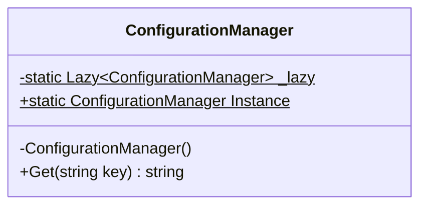

# Singleton Pattern

> Guarantees that a class has only one instance and provides a global point of access to it.

---

## 1. Intent
The **Singleton** pattern ensures that only one object of a specific class exists throughout the entire lifetime of the application. It provides a single, controlled access point to that instance.

---

## 2. Problem (Bad Code Example)

Imagine you are managing an in-memory configuration or a connection pool. If any part of your code can call `new AppConfiguration()`, you end up with multiple instances, inconsistent values, and wasted resources.

A naive attempt to prevent multiple instances looks like this:

```csharp
// BAD: Naive Singleton (NOT thread-safe!)
public class NaiveConfigurationManager
{
    private static NaiveConfigurationManager? _instance;

    // Private constructor prevents calling "new" from outside
    private NaiveConfigurationManager() { }

    public static NaiveConfigurationManager GetInstance()
    {
        // BUG: In a multi-threaded web application, two threads can check
        // this condition at the exact same millisecond. Both see null,
        // and both create a separate instance!
        if (_instance == null)
        {
            _instance = new NaiveConfigurationManager();
        }
        return _instance;
    }
}
```

### Why this is bad:
- **Race Condition**: Under concurrent HTTP requests in ASP.NET Core, multiple threads will execute `_instance == null` simultaneously. You end up with multiple instances in memory.
- **Data Inconsistency**: Changes made to one instance are not visible to the other instance.

---

## 3. Solution & Code Example

In modern C# and .NET 8, the cleanest and most reliable way to implement a thread-safe Singleton is using `System.Lazy<T>`.

`Lazy<T>` guarantees thread safety and lazy initialization (the object is created only when it is requested for the very first time):

```csharp
// GOOD: Modern, thread-safe Singleton using Lazy<T>
public sealed class ConfigurationManager
{
    // Lazy<T> handles thread safety and lazy allocation internally
    private static readonly Lazy<ConfigurationManager> _lazy =
        new(() => new ConfigurationManager());

    // Public access point
    public static ConfigurationManager Instance => _lazy.Value;

    // Private constructor guarantees no outside instantiation
    private ConfigurationManager()
    {
        // Initialization code (e.g., load settings from disk)
        Settings = new Dictionary<string, string>
        {
            ["AppVersion"] = "1.0.0",
            ["Environment"] = "Production"
        };
    }

    public Dictionary<string, string> Settings { get; }

    public string Get(string key) => Settings.GetValueOrDefault(key, "Not Found");
}
```

---

## 4. Structure



- **`sealed class`**: Prevents inheritance, which could allow subclasses to create additional instances.
- **Private constructor**: Prevents direct instantiation with the `new` keyword.
- **`Lazy<T>` static field**: Thread-safe holder for the single instance.
- **`Instance` property**: The public access point.

---

## 5. Singleton vs. Static Class

A common question is: *"Why not just use a `static class`?"*

| Feature | Singleton Pattern | Static Class |
|---|---|---|
| **Can implement an interface (`IInterface`)** | ✅ Yes | ❌ No |
| **Can be passed as a method parameter** | ✅ Yes (as an object) | ❌ No |
| **Works with Dependency Injection (DI)** | ✅ Yes (`AddSingleton`) | ❌ No |
| **Lazy Initialization** | ✅ Yes (initialized when first accessed) | ⚠️ Loaded when class is first referenced by the CLR |
| **Easy to mock in Unit Tests** | ✅ Yes (via interface) | ❌ Very hard to mock |

> **Rule of thumb:** Use a **static class** only for stateless utility functions (like `Math.Round` or string extensions). Use a **Singleton** when you need state, an interface, or DI integration.

---

## 6. In ASP.NET Core

In ASP.NET Core, you almost **never** write custom `Lazy<T>` singletons manually. The built-in Dependency Injection (DI) container manages singletons for you!

### Registration in `Program.cs`
```csharp
var builder = WebApplication.CreateBuilder(args);

// Registers ICacheService as a Singleton.
// ASP.NET Core creates exactly ONE instance for the entire lifetime of the web app.
builder.Services.AddSingleton<ICacheService, InMemoryCacheService>();

var app = builder.Build();
```

### Thread Safety Warning
Because every HTTP request in ASP.NET Core runs on a different thread, all concurrent requests share the **same singleton instance**. Therefore:
- Singleton services must be **thread-safe**.
- Avoid mutable state unless protected by `ConcurrentDictionary` or synchronization primitives.

---

## 7. The DI Lifetime Trap (Captive Dependency)

> [!CAUTION]
> **A Singleton must NEVER inject a Scoped service directly.**

In ASP.NET Core, services have three lifetimes:
1. **Transient**: Created every time they are requested.
2. **Scoped**: Created once per HTTP request (e.g., `AppDbContext`).
3. **Singleton**: Created once for the lifetime of the application.

### The Problem (Captive Dependency)
If a Singleton injects a Scoped service (like `AppDbContext`), the scoped service is **captured** by the singleton and lives forever. This causes:
- Concurrency errors (`A second operation was started on this context instance before a previous operation completed`).
- Memory leaks (the DbContext change tracker grows indefinitely).
- Stale data.

ASP.NET Core detects this in Development mode and throws an `InvalidOperationException`:
`"Cannot consume scoped service 'AppDbContext' from singleton 'MySingletonService'."`

### How to Safely Use a Scoped Service inside a Singleton
If your singleton worker really needs to use a `DbContext`, inject `IServiceScopeFactory`:

```csharp
public class BackgroundWorker(IServiceScopeFactory scopeFactory) : BackgroundService
{
    protected override async Task ExecuteAsync(CancellationToken stoppingToken)
    {
        while (!stoppingToken.IsCancellationRequested)
        {
            // Create an explicit short-lived scope
            using (var scope = scopeFactory.CreateScope())
            {
                var db = scope.ServiceProvider.GetRequiredService<AppDbContext>();
                var pendingJobs = await db.Jobs.Where(j => !j.IsDone).ToListAsync(stoppingToken);
                // process jobs...
            } // Scope and DbContext are safely disposed here

            await Task.Delay(TimeSpan.FromMinutes(1), stoppingToken);
        }
    }
}
```

---

## 8. Connection to SOLID Principles

- **SRP (Single Responsibility Principle)**: Classic GoF Singletons often violate SRP because they manage their own lifecycle *and* perform business tasks. Using ASP.NET Core's `AddSingleton` fixes this by delegating lifecycle management to the DI container.
- **DIP (Dependency Inversion Principle)**: Registering singletons via interfaces (`AddSingleton<ICacheService, MemoryCacheService>()`) satisfies DIP by ensuring consumers depend on abstractions, not concrete singletons.

---

## 9. When to Use
- **Shared Caches**: In-memory caching (`IMemoryCache`).
- **Heavy, Stateless Services**: Expensive objects that are safe to share across threads.
- **Hardware/Resource Gateways**: A client that manages a socket pool or serial port.

---

## 10. When NOT to Use (Over-engineering Warning)
- Do not use Singleton just to pass data globally across classes (this turns the pattern into an anti-pattern: the "Global Variable" smell).
- Do not make services Singletons if they hold user-specific or request-specific state. Use **Scoped** instead.

---

## 11. Pros and Cons

| Pros | Cons |
|---|---|
| Guarantees exactly one instance across the application | Hard to unit test if using a hardcoded static `Instance` |
| Saves RAM for resource-heavy objects | Can introduce concurrency bugs if internal state is not thread-safe |
| Lazy initialization delays resource allocation until needed | Risk of **Captive Dependencies** if injecting scoped services |

---

## 12. Related Patterns
- **Factory Method**: Often implemented as a Singleton.
- **Facade**: Often implemented as a Singleton when stateless.
- **State Pattern**: State objects are often implemented as Singletons to avoid allocating memory for states repeatedly.

---

## 13. Runnable Project
A complete, runnable .NET 8 console project demonstrating:
1. Thread-safe `Lazy<T>` Singleton identity verification across threads.
2. ASP.NET Core DI `AddSingleton` usage.
3. Safe resolution of scoped dependencies via `IServiceScopeFactory`.

To run the project:
```bash
cd code
dotnet run
```
