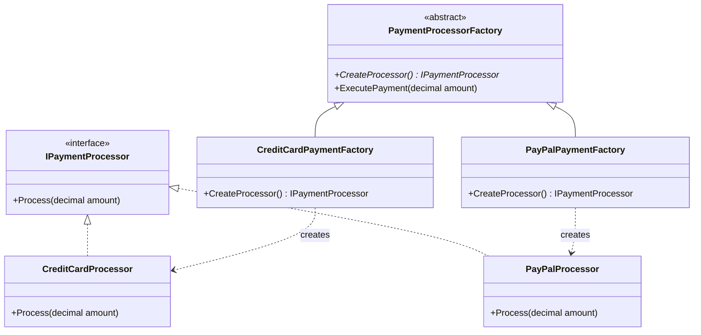

# Factory Method Pattern

> Defines an interface or method for creating an object, but lets subclasses or factories decide which class to instantiate.

---

## 1. Intent
The **Factory Method** pattern separates the code that **uses** an object from the code that **creates** that object.

Instead of calling `new ConcreteClass()` directly inside your business logic, you call a dedicated method (a "factory method") that returns an interface or base class.

---

## 2. Problem (Bad Code Example)

Imagine an e-commerce order system. When a customer checks out, the system must process payment using different providers (Credit Card, PayPal, or Bank Transfer).

Without a factory, the checkout service constructs concrete objects directly using `if/else` or `switch`:

```csharp
// BAD: Direct instantiation with tight coupling
public class CheckoutService
{
    public void ProcessOrder(string paymentType, decimal amount)
    {
        IPaymentProcessor processor;

        if (paymentType == "CreditCard")
        {
            // Direct dependency on concrete class and its setup
            processor = new CreditCardPaymentProcessor("api-key-123");
        }
        else if (paymentType == "PayPal")
        {
            // Direct dependency on PayPal details
            processor = new PayPalPaymentProcessor("client-id", "secret");
        }
        else
        {
            throw new NotSupportedException($"Payment type '{paymentType}' is not supported.");
        }

        processor.Process(amount);
    }
}
```

### Why this is bad:
- **Violates Open/Closed Principle (OCP)**: Every time your company adds a new payment provider (e.g., Apple Pay), you must modify `CheckoutService`.
- **Violates Single Responsibility Principle (SRP)**: `CheckoutService` now has two jobs: processing orders AND knowing how to construct and configure every payment provider.
- **Hard to Test**: You cannot easily unit test `CheckoutService` without also pulling in the concrete dependencies.

---

## 3. Solution & Code Example

We create a common interface `IPaymentProcessor` and delegate the creation of each processor to a dedicated method or factory.

```csharp
// 1. Common Product Interface
public interface IPaymentProcessor
{
    void Process(decimal amount);
}

// 2. Concrete Products
public class CreditCardProcessor : IPaymentProcessor
{
    public void Process(decimal amount) =>
        Console.WriteLine($"Charging ${amount} to Credit Card.");
}

public class PayPalProcessor : IPaymentProcessor
{
    public void Process(decimal amount) =>
        Console.WriteLine($"Charging ${amount} to PayPal.");
}

// 3. Creator with the Factory Method
public abstract class PaymentProcessorFactory
{
    // The Factory Method
    public abstract IPaymentProcessor CreateProcessor();

    // Business operation that uses the created product
    public void ExecutePayment(decimal amount)
    {
        var processor = CreateProcessor();
        processor.Process(amount);
    }
}

// 4. Concrete Creators deciding which product to create
public class CreditCardPaymentFactory : PaymentProcessorFactory
{
    public override IPaymentProcessor CreateProcessor() => new CreditCardProcessor();
}

public class PayPalPaymentFactory : PaymentProcessorFactory
{
    public override IPaymentProcessor CreateProcessor() => new PayPalProcessor();
}
```

Now `ExecutePayment` only interacts with the `IPaymentProcessor` interface. Adding a new payment method requires adding a new class, not touching existing tested code.

### Implementation Steps

1. **Create the Product Interface**: Define a common interface or abstract base class (e.g., `IPaymentProcessor`) specifying the contract for all products.
2. **Create Concrete Products**: Implement the product interface in separate classes with their specific logic (e.g., `CreditCardProcessor`, `PayPalProcessor`).
3. **Create the Abstract Creator**: Declare an abstract creator class (e.g., `PaymentProcessorFactory`) that defines the abstract Factory Method (`CreateProcessor()`) and any high-level operations that rely on it.
4. **Create Concrete Creators**: Inherit from the abstract creator and override the Factory Method to instantiate and return specific concrete products.
5. **Use the Creator in Client Code**: Invoke operations via the creator abstraction without directly depending on concrete product classes.
6. **Extend Easily (Open/Closed Principle)**: Add new product types at any time by introducing new concrete products and creators without modifying existing code.

---

## 4. Structure



- **`IPaymentProcessor` (Product Interface)**: Declares the contract common to all products.
- **`CreditCardProcessor` / `PayPalProcessor` (Concrete Products)**: The actual implementations.
- **`PaymentProcessorFactory` (Creator)**: Declares the factory method returning `IPaymentProcessor`.
- **`CreditCardPaymentFactory` (Concrete Creator)**: Overrides the factory method to return a specific product.

---

## 5. In ASP.NET Core

In modern ASP.NET Core (.NET 8), the framework provides two primary ways to implement the Factory Method pattern:

### A. Built-in `IHttpClientFactory`
`IHttpClientFactory` is the most widely used Factory Method in .NET. Instead of directly calling `new HttpClient()`, you call `factory.CreateClient("name")`:

```csharp
// Program.cs registration
builder.Services.AddHttpClient("GitHub", client =>
{
    client.BaseAddress = new Uri("https://api.github.com/");
    client.DefaultRequestHeaders.Add("User-Agent", "MyApp");
});

// Consumer injection
public class GitHubService(IHttpClientFactory httpClientFactory)
{
    public async Task GetRepoAsync(string repoName)
    {
        // Factory Method creates a configured, pooled HttpClient
        var client = httpClientFactory.CreateClient("GitHub");
        var response = await client.GetAsync($"repos/{repoName}");
    }
}
```

### B. .NET 8 Keyed Services
In .NET 8, you can register multiple implementations of the same interface under different keys. The DI container acts as your runtime factory:

```csharp
// Program.cs
builder.Services.AddKeyedTransient<IPaymentProcessor, CreditCardProcessor>("credit");
builder.Services.AddKeyedTransient<IPaymentProcessor, PayPalProcessor>("paypal");

// Endpoint resolving via Keyed Services
app.MapPost("/checkout/{provider}", (
    string provider,
    decimal amount,
    [FromKeyedServices] IServiceProvider sp) =>
{
    var processor = sp.GetKeyedService<IPaymentProcessor>(provider);
    if (processor is null) return Results.BadRequest("Invalid provider");

    processor.Process(amount);
    return Results.Ok();
});
```

---

## 6. Connection to SOLID Principles

- **Open/Closed Principle (OCP)**: You can introduce new product implementations without breaking or modifying existing client code.
- **Single Responsibility Principle (SRP)**: The product creation code is separated into one dedicated place instead of scattered across business logic.
- **Dependency Inversion Principle (DIP)**: Clients depend on the product interface (`IPaymentProcessor`), never on concrete classes (`CreditCardProcessor`).

---

## 7. When to Use
- When you do not know beforehand the exact types and dependencies of the objects your code will work with.
- When you want to decouple object creation from object usage.
- When you want to reuse existing resources or configure complex objects (like `IHttpClientFactory` pooling message handlers).

---

## 8. When NOT to Use (Over-engineering Warning)
- If you have only **one** concrete implementation and it will never vary, do not create an abstract factory hierarchy. Use simple constructor injection or `new`.
- Do not create a factory for simple data models or DTOs. Factories are for objects with **behavior** and **dependencies**.

---

## 9. Pros and Cons

| Pros (Advantages) | Cons (Disadvantages) |
|---|---|
| Avoids tight coupling between creator and concrete products | Introduces multiple extra classes and interfaces |
| Satisfies Open/Closed Principle (easy to add new types) | Can be over-engineering for simple applications |
| Centralizes object creation and simplifies unit testing | |

---

## 10. Related Patterns
- **Abstract Factory**: Factory Method creates a single product; Abstract Factory creates entire families of related products.
- **Template Method**: A Factory Method is often called as one step inside a larger Template Method.
- **Prototype**: An alternative way to create objects without subclassing, by cloning existing instances.

---

## 11. Runnable Project
See the full runnable .NET 8 project in the [`code/`](./code/) folder.

Run it with:
```bash
cd code
dotnet run
```
