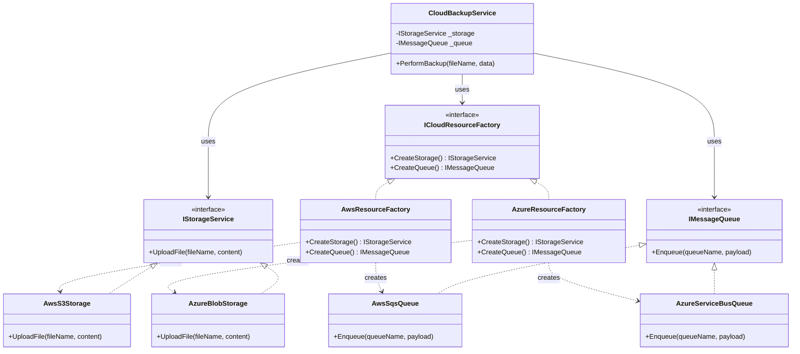

# Abstract Factory Pattern

> Provides an interface for creating families of related or dependent objects without specifying their concrete classes.

---

## 1. Intent

The **Abstract Factory** pattern tackles a specific problem: creating **entire families of related objects** that are designed to work together.

Instead of having client code create individual products directly using `new` (or mixing and matching incompatible products from different vendors/environments), the client relies on an abstract factory interface. This interface declares a set of creation methods for every product in the family, guaranteeing that the created products are always mutually compatible.

---

## 2. Problem (Bad Code Example)

Imagine a cloud-agnostic backup service in an enterprise backend. The system needs to support multiple cloud providers (**AWS** and **Azure**). Each cloud provider requires two related services to work together:
1. **Blob/Object Storage** (e.g., AWS S3 or Azure Blob Storage)
2. **Message Queue** (e.g., AWS SQS or Azure Service Bus)

Without an Abstract Factory, the service directly instantiates concrete classes using branching logic or scattered `new` expressions:

```csharp
// BAD: Direct instantiation and mixed product families
public class CloudBackupService
{
    private readonly string _cloudProvider;

    public CloudBackupService(string cloudProvider)
    {
        _cloudProvider = cloudProvider;
    }

    public void PerformBackup(string fileName, byte[] data)
    {
        IStorageService storage;
        IMessageQueue queue;

        if (_cloudProvider == "AWS")
        {
            storage = new AwsS3Storage();
            queue = new AwsSqsQueue();
        }
        else if (_cloudProvider == "Azure")
        {
            storage = new AzureBlobStorage();
            // BUG: Accidental mismatch! A developer mistakenly paired Azure storage with AWS queue
            queue = new AwsSqsQueue(); 
        }
        else
        {
            throw new NotSupportedException($"Provider {_cloudProvider} not supported.");
        }

        storage.UploadFile(fileName, data);
        queue.Enqueue("backup-notifications", $"File {fileName} uploaded.");
    }
}
```

### Why this is bad:
- **Product Mismatch Risk**: Nothing prevents a developer from mistakenly pairing an AWS S3 storage with an Azure Service Bus queue. Incompatible components from different families can be mixed up at runtime.
- **Violates Open/Closed Principle (OCP)**: Adding a third cloud provider (like Google Cloud Platform) requires editing every service and every `if/else` block across the codebase.
- **Tight Coupling**: `CloudBackupService` directly depends on four concrete vendor classes (`AwsS3Storage`, `AwsSqsQueue`, `AzureBlobStorage`, `AzureServiceBusQueue`) and their initialization parameters.
- **Violates Single Responsibility Principle (SRP)**: The business service is responsible for both coordinating backups AND knowing how to assemble multi-vendor infrastructure suites.

---

## 3. Solution & Code Example

1. Define abstract product interfaces (`IStorageService`, `IMessageQueue`).
2. Create an abstract factory interface (`ICloudResourceFactory`) declaring a creation method for each product in the family.
3. Implement concrete factories (`AwsResourceFactory`, `AzureResourceFactory`) that produce matching products belonging to their respective ecosystem.
4. The client depends solely on the abstract factory and product interfaces.

```csharp
// 1. Abstract Products
public interface IStorageService
{
    void UploadFile(string fileName, byte[] content);
}

public interface IMessageQueue
{
    void Enqueue(string queueName, string payload);
}

// 2. Concrete Products: Family 1 (AWS)
public class AwsS3Storage : IStorageService
{
    public void UploadFile(string fileName, byte[] content) =>
        Console.WriteLine($"[AWS S3] Uploaded {fileName} ({content.Length} bytes).");
}

public class AwsSqsQueue : IMessageQueue
{
    public void Enqueue(string queueName, string payload) =>
        Console.WriteLine($"[AWS SQS] Enqueued message to {queueName}: {payload}");
}

// 2. Concrete Products: Family 2 (Azure)
public class AzureBlobStorage : IStorageService
{
    public void UploadFile(string fileName, byte[] content) =>
        Console.WriteLine($"[Azure Blob] Stored {fileName} ({content.Length} bytes).");
}

public class AzureServiceBusQueue : IMessageQueue
{
    public void Enqueue(string queueName, string payload) =>
        Console.WriteLine($"[Azure Service Bus] Sent message to {queueName}: {payload}");
}

// 3. Abstract Factory Interface
public interface ICloudResourceFactory
{
    IStorageService CreateStorage();
    IMessageQueue CreateQueue();
}

// 4. Concrete Factories
public class AwsResourceFactory : ICloudResourceFactory
{
    public IStorageService CreateStorage() => new AwsS3Storage();
    public IMessageQueue CreateQueue() => new AwsSqsQueue();
}

public class AzureResourceFactory : ICloudResourceFactory
{
    public IStorageService CreateStorage() => new AzureBlobStorage();
    public IMessageQueue CreateQueue() => new AzureServiceBusQueue();
}

// 5. Client Code (Guaranteed compatible family of products)
public class CloudBackupService(ICloudResourceFactory factory)
{
    private readonly IStorageService _storage = factory.CreateStorage();
    private readonly IMessageQueue _queue = factory.CreateQueue();

    public void PerformBackup(string fileName, byte[] data)
    {
        _storage.UploadFile(fileName, data);
        _queue.Enqueue("backup-notifications", $"Backup completed for {fileName}");
    }
}
```

### Implementation Steps

1. **Identify the Product Families**: Determine which distinct products belong together (e.g., `Storage` + `Queue`).
2. **Define Product Interfaces**: Create individual interfaces for each product role (`IStorageService`, `IMessageQueue`).
3. **Define the Abstract Factory Interface**: Declare a contract (`ICloudResourceFactory`) containing factory methods for each product interface (`CreateStorage()`, `CreateQueue()`).
4. **Implement Concrete Families**: For each environment or vendor, create concrete product classes implementing their respective interfaces.
5. **Implement Concrete Factories**: For each family, implement the factory interface, instantiating only the products belonging to that family.
6. **Inject the Factory into Client Code**: Inject `ICloudResourceFactory` into high-level services. The client consumes products via their interfaces without knowing concrete types.

---

## 4. Structure



- **`ICloudResourceFactory` (Abstract Factory)**: Declares creation methods for each product in the family.
- **`AwsResourceFactory` / `AzureResourceFactory` (Concrete Factories)**: Instantiate products for a specific family.
- **`IStorageService` / `IMessageQueue` (Abstract Products)**: Declare interfaces for distinct product types.
- **`AwsS3Storage` / `AzureBlobStorage` (Concrete Products)**: Family-specific implementations of the product interfaces.
- **`CloudBackupService` (Client)**: Consumes the products through their abstract interfaces, unaware of concrete classes.

---

## 5. In ASP.NET Core

### A. The Canonical .NET Example: `DbProviderFactory`
The most prominent built-in Abstract Factory in .NET is `System.Data.Common.DbProviderFactory` (ADO.NET). When connecting to SQL Server, PostgreSQL, or SQLite, a single factory produces a coordinated family of database objects:

```csharp
// DbProviderFactory creates a complete family of ADO.NET objects:
public abstract class DbProviderFactory
{
    public virtual DbConnection CreateConnection();
    public virtual DbCommand CreateCommand();
    public virtual DbParameter CreateParameter();
    public virtual DbDataAdapter CreateDataAdapter();
}

// Usage: The client works with any database without knowing the driver
public class ReportGenerator(DbProviderFactory dbFactory, string connectionString)
{
    public void Generate()
    {
        using var connection = dbFactory.CreateConnection();
        connection.ConnectionString = connectionString;
        connection.Open();

        using var command = dbFactory.CreateCommand();
        command.Connection = connection;
        command.CommandText = "SELECT COUNT(*) FROM Users";
        
        var count = command.ExecuteScalar();
    }
}
```

### B. Configuration-Driven DI Registration in ASP.NET Core
In modern ASP.NET Core, you register the concrete factory family once at application startup based on `appsettings.json`:

```csharp
// Program.cs
var builder = WebApplication.CreateBuilder(args);

var provider = builder.Configuration["CloudProvider"] ?? "AWS";

// Register the appropriate family factory as a Singleton
if (provider.Equals("Azure", StringComparison.OrdinalIgnoreCase))
{
    builder.Services.AddSingleton<ICloudResourceFactory, AzureResourceFactory>();
}
else
{
    builder.Services.AddSingleton<ICloudResourceFactory, AwsResourceFactory>();
}

builder.Services.AddScoped<CloudBackupService>();
```

### C. Multi-Tenant Keyed Services in .NET 8
In multi-tenant or hybrid-cloud architectures, different customers may require different cloud backends. .NET 8 keyed services allow resolving full product families on demand:

```csharp
// Program.cs
builder.Services.AddKeyedSingleton<ICloudResourceFactory, AwsResourceFactory>("aws");
builder.Services.AddKeyedSingleton<ICloudResourceFactory, AzureResourceFactory>("azure");

// Minimal API resolving factory family by tenant header
app.MapPost("/backup", (
    [FromHeader(Name = "X-Tenant-Cloud")] string tenantCloud,
    [FromKeyedServices] IServiceProvider sp) =>
{
    var factory = sp.GetKeyedService<ICloudResourceFactory>(tenantCloud)
                  ?? throw new InvalidOperationException("Unsupported cloud tenant");

    var backupService = new CloudBackupService(factory);
    backupService.PerformBackup("report.pdf", [1, 2, 3]);

    return Results.Ok();
});
```

---

## 6. Connection to SOLID Principles

- **Open/Closed Principle (OCP)**: You can introduce new product families (e.g., `GcpResourceFactory` producing Google Cloud Storage and GCP Pub/Sub) without altering any existing client code or factories.
- **Single Responsibility Principle (SRP)**: Product creation logic for an entire suite is consolidated inside one dedicated factory class.
- **Dependency Inversion Principle (DIP)**: High-level client services depend on abstract factory and product interfaces (`ICloudResourceFactory`, `IStorageService`, `IMessageQueue`), never on concrete provider classes.
- **Interface Segregation Principle (ISP)**: Each product exposes a fine-grained, focused interface rather than one bloated multi-purpose contract.

---

## 7. When to Use

- When your system needs to be independent of how its products are created, composed, and represented.
- When your system must be configured with one of multiple **families** of products (e.g., AWS vs Azure vs GCP, Windows vs macOS, Dark Theme vs Light Theme).
- When a family of related product objects is designed to be used together, and you need to enforce this constraint to prevent mismatched components.

---

## 8. When NOT to Use (Over-engineering Warning)

- **Only a single product type is being created**: If you only need to instantiate an `IPaymentProcessor`, use the **Factory Method** pattern. Abstract Factory is meant for *families* of multiple related products.
- **The product family structure changes frequently**: Adding a new product method (e.g., `CreateCache()`) requires updating the `ICloudResourceFactory` interface and editing **every single concrete factory class**.
- **Simple, static applications**: If your app will only ever run on Azure and will never switch or support hybrid providers, a direct service registration in DI is simpler and sufficient.

---

## 9. Pros and Cons

| Pros (Advantages) | Cons (Disadvantages) |
|---|---|
| **Guaranteed Compatibility**: Products created from a factory are guaranteed to be mutually compatible. | **Increased Code Complexity**: Introduces a high number of new interfaces, factories, and product classes. |
| **Decouples Client from Concrete Classes**: Client code remains completely agnostic of vendor-specific logic. | **Difficult to Extend Product Types**: Adding a new product to the family requires changing the abstract factory and all concrete factories. |
| **Adheres to OCP and SRP**: Easy to add new families without breaking existing systems. | |

---

## 10. Related Patterns

| Pattern | Relationship with Abstract Factory |
|---|---|
| **Factory Method** | Factory Method creates **one** product using inheritance (`CreateProcessor()`). Abstract Factory creates **families of products** using composition. Concrete factories often use Factory Methods internally to create individual products. |
| **Builder** | Builder focuses on constructing a single complex object step-by-step. Abstract Factory focuses on creating families of distinct, simple or complex objects in a single call. |
| **Prototype** | Concrete factory implementations can be implemented using Prototype by storing prototypes of products and cloning them instead of instantiating with `new`. |
| **Singleton** | Concrete factory classes are often implemented as Singletons because only one instance of a factory is needed per application lifetime. |

---

## 11. Runnable Project

A complete, runnable .NET 8 console application demonstrating:
1. Classic GoF Abstract Factory (AWS vs Azure resource suites)
2. ASP.NET Core DI configuration-based resolution
3. Modern .NET 8 Keyed Services for multi-tenant cloud resolution

Explore the code in the [`code/`](./code/) folder.

Run it with:
```bash
cd code
dotnet run
```
